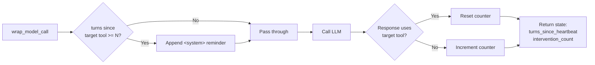
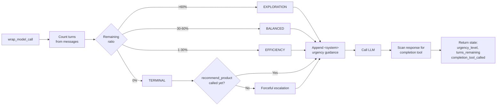
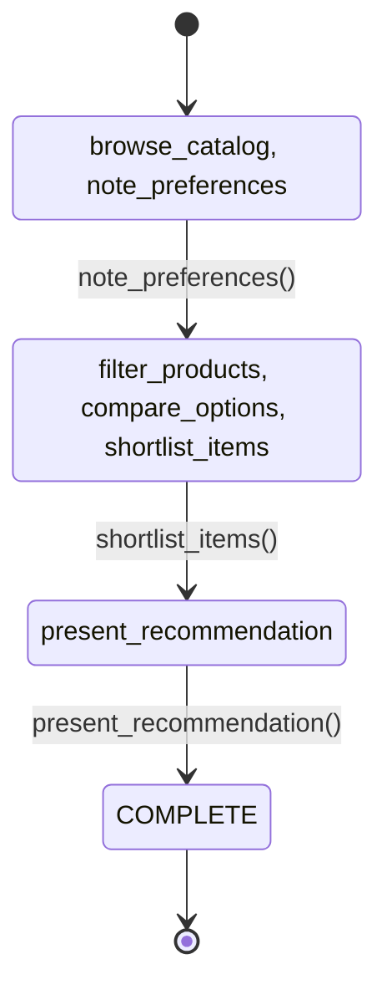
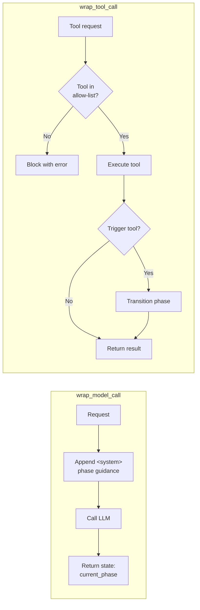

# Behavior-Steering Middleware Examples

Three working examples of behavior-steering middleware patterns for LangGraph agents. These patterns
demonstrate how to shape agent behavior at the orchestration layer without modifying underlying models.

## Overview

Behavior-Steering Middleware (BSM) intercepts agent execution flows to dynamically adjust behavior
based on runtime context. Each middleware extends `AgentMiddleware` from `langchain.agents.middleware`
and hooks into `create_agent` via `wrap_model_call`, `after_model`, and `wrap_tool_call`. Steering
content is injected as `<system>`-tagged messages appended to the conversation — the system prompt is
static and only declares that `<system>` tags will appear. State updates flow back to the agent via
`ExtendedModelResponse` and `Command(update={...})`.

| Pattern | Scenario | Use Case |
|---------|----------|----------|
| **Worker Heartbeat Monitor** | Research agent that must periodically report status | Detecting silent tool-call gaps in long-running agents |
| **Shopping Recommendation Agent** | Product advisor with a fixed turn budget | Budget-constrained conversations requiring a definite outcome |
| **Tool-Triggered Personalization** | Personal shopping assistant progressing through workflow phases | Deterministic multi-phase workflows driven by tool calls |

## Quick Start

```bash
# Install dependencies
poetry install

# Configure API key
cp .env.example .env
# Edit .env and add your OPENAI_API_KEY

# Run individual demos (each requires OPENAI_API_KEY)
poetry run python -m bsm_examples.drift_detection.demo
poetry run python -m bsm_examples.turn_urgency.demo
poetry run python -m bsm_examples.phase_steering.demo

# Run all tests
poetry run pytest tests/ -v
```

## Pattern 1: Worker Heartbeat Monitor

**Problem:** Agents absorbed in multi-step tasks stop calling a designated reporting tool (e.g.
`send_message`), leaving the system with no visibility into agent progress.

**Solution:** `HeartbeatMiddleware` tracks turns since the last call to the target tool. When silence
exceeds `max_silent_turns`, it injects a `<system>` reminder into the next model call.



```python
from langchain.agents import create_agent
from langchain_openai import ChatOpenAI
from langchain.tools import tool
from bsm_examples.drift_detection import (
    HeartbeatConfig,
    HeartbeatMiddleware,
    HeartbeatAgentState,
)


@tool
def send_message(message: str) -> str:
    """Send a status update message to the team."""
    return f"Message sent: {message}"


@tool
def do_research(topic: str) -> str:
    """Research a topic and return findings."""
    return f"Research findings on '{topic}': ..."


config = HeartbeatConfig(
    target_tool="send_message",
    max_silent_turns=2,
    max_interventions=3,
    cooldown_turns=1,
)
middleware = HeartbeatMiddleware(config)

agent = create_agent(
    model=ChatOpenAI(model="gpt-4.1-mini"),
    tools=[send_message, do_research],
    system_prompt=(
        "You are a research agent. Keep the team informed via the `send_message` tool. "
        "You will receive <system> tags with guidance — follow them."
    ),
    middleware=[middleware],
    state_schema=HeartbeatAgentState,
)

result = agent.invoke({"messages": [HumanMessage(content="Research renewable energy storage.")]})
turns_since = result.get("turns_since_heartbeat")
interventions = result.get("intervention_count")
```

**Key features:**
- Single target tool monitored per middleware instance
- Configurable silence threshold (`max_silent_turns`), intervention cap, and cooldown
- Reminder text is a configurable template with `{turns_since}` and `{tool}` placeholders
- `HeartbeatAgentState` exposes `turns_since_heartbeat` and `intervention_count`

## Pattern 2: Shopping Recommendation Agent

**Problem:** Agents maintain consistent exploratory behavior regardless of remaining turn budget,
spending all turns on questions and never delivering a recommendation.

**Solution:** `TurnUrgencyMiddleware` computes urgency from the remaining turn ratio and appends an
urgency-tagged `<system>` modifier on every model call, shifting the agent from exploratory to
decisive. When `required_completion_tool` is set, the middleware escalates to `TERMINAL` urgency
until that tool is called.



```python
from langchain.agents import create_agent
from langchain_openai import ChatOpenAI
from langchain.tools import tool
from bsm_examples.turn_urgency import (
    TurnUrgencyConfig,
    TurnUrgencyMiddleware,
    UrgencyAgentState,
)


@tool
def search_products(query: str, category: str = "all") -> str:
    """Search for products matching a query in the catalog."""
    return f"Found products for '{query}' in {category}: [results]"


@tool
def recommend_product(product_name: str, reason: str) -> str:
    """Recommend a product to the customer with a reason."""
    return f"Recommended '{product_name}': {reason}"


config = TurnUrgencyConfig(
    max_turns=5,
    required_completion_tool="recommend_product",
)
middleware = TurnUrgencyMiddleware(config)

agent = create_agent(
    model=ChatOpenAI(model="gpt-4.1-mini"),
    tools=[search_products, recommend_product],
    system_prompt=(
        "You are a shopping assistant. Help customers find the right product. "
        "You will receive <system> tags with behavioral guidance — follow them."
    ),
    middleware=[middleware],
    state_schema=UrgencyAgentState,
)

result = agent.invoke({"messages": messages})
urgency_level = result.get("urgency_level")         # "EXPLORATION" | "BALANCED" | ...
turns_remaining = result.get("turns_remaining")
completion_tool_called = result.get("completion_tool_called")
```

**Urgency levels:**

| Level | Budget remaining | Injected behavior |
|-------|-----------------|-------------------|
| **EXPLORATION** | >60% | Ask clarifying questions, explore options |
| **BALANCED** | 30-60% | Narrow options, limit follow-up questions |
| **EFFICIENCY** | <30% | Work toward a recommendation |
| **TERMINAL** | Final turn | Call the completion tool immediately |

`UrgencyAgentState` exposes `urgency_level`, `turns_used`, `turns_remaining`, and
`completion_tool_called`. Three turn-counting modes are supported via `count_human_turns_only` and
`count_agent_turns_only`.

## Pattern 3: Tool-Triggered Personalization

**Problem:** Multi-step workflows lack structure — agents skip phases, stall indefinitely, or ignore
per-phase tool constraints without reliable enforcement.

**Solution:** `PhaseSteeringMiddleware` detects phase transitions in `wrap_tool_call` (after a
trigger tool executes) and injects phase-appropriate `<system>` guidance in `wrap_model_call`.
Transitions are deterministic — no heuristics, no ambiguity.





```python
from langchain.agents import create_agent
from langchain_openai import ChatOpenAI
from langchain.tools import tool
from bsm_examples.phase_steering import (
    Phase,
    PhaseBehavior,
    PhaseConfig,
    PhaseTransitionRule,
    PhaseSteeringMiddleware,
    PhaseAgentState,
)


@tool
def browse_catalog(category: str) -> str:
    """Browse products in a catalog category."""
    return f"Catalog for '{category}': [products]"


@tool
def note_preferences(preferences: str) -> str:
    """Record the customer's stated preferences and requirements."""
    return f"Preferences noted: {preferences}"


@tool
def shortlist_items(items: str) -> str:
    """Create a shortlist of top candidate products."""
    return f"Shortlisted: {items}"


@tool
def present_recommendation(recommendation: str) -> str:
    """Present the final product recommendation to the customer."""
    return f"Final recommendation: {recommendation}"


config = PhaseConfig(
    phases={
        Phase.DISCOVERY: PhaseBehavior(
            system_prompt_addition=(
                "Ask questions to understand needs. Browse the catalog. "
                "When ready, use note_preferences."
            ),
            allowed_tools=["browse_catalog", "note_preferences"],
            max_iterations=5,
        ),
        Phase.CURATION: PhaseBehavior(
            system_prompt_addition=(
                "Filter and compare products. When narrowed down, use shortlist_items."
            ),
            allowed_tools=["filter_products", "compare_options", "shortlist_items"],
            max_iterations=5,
        ),
        Phase.RECOMMENDATION: PhaseBehavior(
            system_prompt_addition="Present your final recommendation.",
            allowed_tools=["present_recommendation"],
            max_iterations=2,
        ),
        Phase.COMPLETE: PhaseBehavior(
            system_prompt_addition="Workflow complete.",
            allowed_tools=[],
            max_iterations=1,
        ),
    },
    transitions=[
        PhaseTransitionRule(
            from_phase=Phase.DISCOVERY,
            to_phase=Phase.CURATION,
            trigger_tool="note_preferences",
        ),
        PhaseTransitionRule(
            from_phase=Phase.CURATION,
            to_phase=Phase.RECOMMENDATION,
            trigger_tool="shortlist_items",
        ),
        PhaseTransitionRule(
            from_phase=Phase.RECOMMENDATION,
            to_phase=Phase.COMPLETE,
            trigger_tool="present_recommendation",
        ),
    ],
    initial_phase=Phase.DISCOVERY,
)
middleware = PhaseSteeringMiddleware(config)

agent = create_agent(
    model=ChatOpenAI(model="gpt-4.1-mini"),
    tools=[browse_catalog, note_preferences, shortlist_items, present_recommendation],
    system_prompt=(
        "You are a personalization shopping assistant. "
        "You will receive <system> tags with phase guidance — follow them and "
        "use only the tools specified for the current phase."
    ),
    middleware=[middleware],
    state_schema=PhaseAgentState,
)

result = agent.invoke({"messages": conversation})
current_phase = result.get("current_phase")
phase_iteration = result.get("phase_iteration")
total_iterations = result.get("total_iterations")
```

**Phase transitions:**

| Trigger tool | From phase | To phase |
|-------------|-----------|---------|
| `note_preferences` | DISCOVERY | CURATION |
| `shortlist_items` | CURATION | RECOMMENDATION |
| `present_recommendation` | RECOMMENDATION | COMPLETE |

`PhaseAgentState` exposes `current_phase`, `phase_iteration`, and `total_iterations`.
Per-phase `allowed_tools` lists are enforced in `wrap_tool_call` — disallowed calls are blocked
before they reach the underlying tool.

## Project Structure

```
python/behavior-steering-middleware/
├── .env.example
├── pyproject.toml
├── README.md
├── src/bsm_examples/
│   ├── __init__.py
│   ├── drift_detection/            # Worker Heartbeat Monitor
│   │   ├── models.py               # HeartbeatConfig
│   │   ├── state.py                # HeartbeatAgentState
│   │   ├── detector.py             # HeartbeatDetector
│   │   ├── middleware.py           # HeartbeatMiddleware
│   │   ├── demo.py
│   │   └── DIAGRAM.md             # Detailed mermaid flowchart
│   ├── turn_urgency/               # Shopping Recommendation Agent
│   │   ├── models.py               # TurnUrgencyConfig, UrgencyLevel, UrgencyPrompts
│   │   ├── state.py                # UrgencyAgentState
│   │   ├── calculator.py           # UrgencyCalculator, UrgencyState
│   │   ├── middleware.py           # TurnUrgencyMiddleware
│   │   ├── demo.py
│   │   └── DIAGRAM.md             # Detailed mermaid flowchart
│   └── phase_steering/             # Tool-Triggered Personalization
│       ├── models.py               # Phase, PhaseBehavior, PhaseTransitionRule, PhaseConfig
│       ├── state.py                # PhaseAgentState
│       ├── detector.py             # ToolTriggeredDetector
│       ├── middleware.py           # PhaseSteeringMiddleware
│       ├── demo.py
│       └── DIAGRAM.md             # Detailed mermaid flowcharts
└── tests/
    ├── helpers.py
    ├── test_drift_detection.py
    ├── test_turn_urgency.py
    └── test_phase_steering.py
```

## Technical Details

### Dependencies

- **Python:** 3.11+
- **LangChain:** 1.2+ (required for `AgentMiddleware`, `ExtendedModelResponse`)
- **LangGraph:** 1.0+
- **LangChain-OpenAI:** for `ChatOpenAI` in demos
- **Pydantic:** 2.0+

### Code Quality

```bash
# Type checking (strict mode)
poetry run mypy src/

# Linting
poetry run ruff check src/ tests/

# Formatting
poetry run ruff format src/ tests/

# Testing
poetry run pytest tests/ -v
```

### Design Principles

1. **Middleware pattern:** All three examples extend `AgentMiddleware` and integrate via
   `create_agent` without modifying the underlying model or agent logic.
2. **Static system prompt:** The system prompt declares that `<system>` tags will appear but is
   never mutated at runtime. All steering content is appended as separate messages.
3. **Injection via `request.override`:** `wrap_model_call` appends `SystemMessage` objects with
   `<system>` tags to `request.messages` before the model call proceeds.
4. **Tool-triggered transitions:** Phase transitions fire in `wrap_tool_call` after the trigger
   tool executes — no heuristics, no scoring, deterministic advancement.
5. **State observability:** Middleware writes diagnostics back to agent state via
   `ExtendedModelResponse` + `Command(update={...})`, making heartbeat counts, urgency levels,
   and phase tracking accessible on every `agent.invoke` result.
6. **Pydantic configuration:** Type-safe, validated configuration with sensible defaults across
   all three patterns.

## License

MIT License - See LICENSE file in parent repository.
