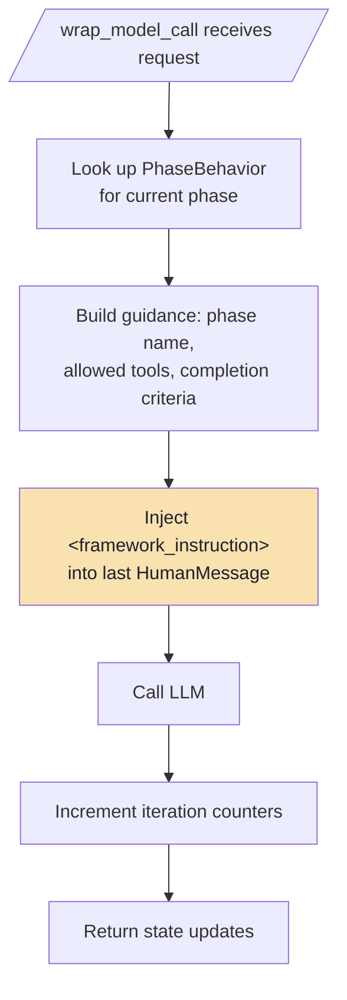
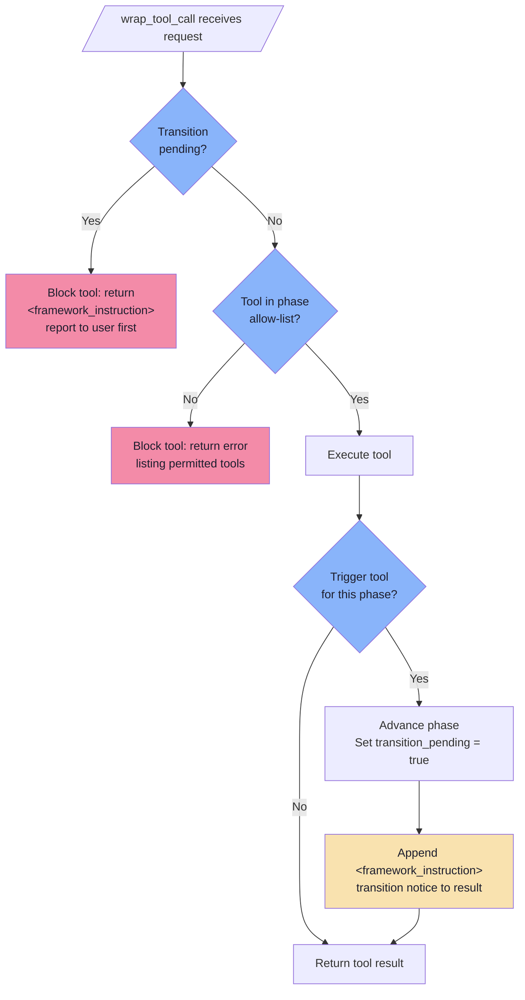
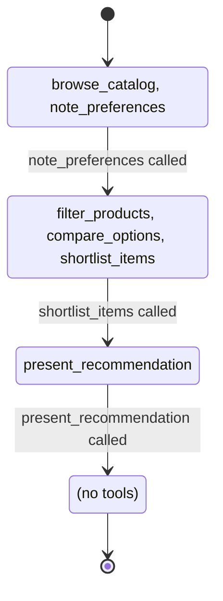

# Tool-Triggered Phase Steering

## wrap_model_call -- Inject Phase Guidance

## wrap_tool_call -- Gate Tools and Trigger Transitions

## Phase Progression

## Lifecycle Note

The `before_agent` hook clears `transition_pending` at the start of each agent
invocation, reopening the tool gate for the new phase.
